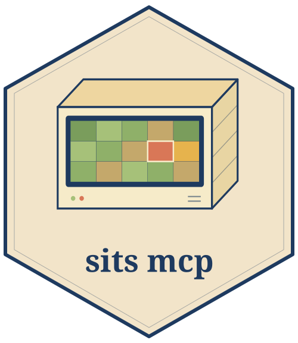

## sitsmcp 

[MCP](https://modelcontextprotocol.io) server exposing SITS R package documentation, function reference, and references.

## Installation

To run the `sitsmcp`, you need to have Python 3.11+ and [uv](https://docs.astral.sh/uv/) installed. Then, to install it, first clone the repository:

```bash
git clone https://github.com/m3nin0-labs/sitsmcp.git
```

Then, access the repository downloaded:

```bash
cd sitsmcp
```

Finally, you can `sync` the dependencies:

```
uv sync
```

## Usage

To start using `sitsmcp`, you first need to create the database (SQLite) for it:

```bash
sitsmcp db init
```

Next, index the reference, book and articles from `sits`:

```bash
sitsmcp index all
```

Then, you can run the server:

```bash
sitsmcp serve 
```

The server listens on `http://127.0.0.1:8000/mcp` by default.

## Configuration

Settings are optional and read from environment variables (prefix `SITSMCP_`) or a `.env` file. See [`.env.example`](.env.example) for the full list and defaults.

## Production

For production environments, you can run the server behind `nginx` and gunicorn (multiple workers) via Docker Compose:

```bash
docker compose up --build
```

The Docker Compose builds an image for the `sitsmcp`, which bakes in the pre-built database and the embedding model. The Compose also stars an `nginx`, which exposes the server on port `80`.

**Note**: Tune the number of gunicorn workers with `WEB_CONCURRENCY` (default `2`). Each worker loads its own copy of the embedding model (`~1.3 GB` of RAM), so raise this only in line with available memory.

## MCP Tools

The `sitsmcp` currently implements the following tools:

| Tool | Purpose |
| --- | --- |
| `sits_get_function` | Full reference documentation for a named SITS function. |
| `sits_search_docs` | Semantic search over the SITS book. |
| `sits_search_references` | Search academic articles that use SITS. |

## Development

```bash
uv sync --extra dev
uv run pytest          # run the test suite
uv run ruff check .    # lint
uv run mypy sitsmcp    # type-check
```

## Contributing

Contributions are welcome. Please open an issue to discuss significant changes, and ensure tests, linting and type checks pass before submitting a pull request.

## License

`sitsmcp` is distributed under the GPL-2.0-only license. See [LICENSE](./LICENSE) for the full text.
